  

  

  
  
  

  <a href="#-about">About</a> &nbsp;·&nbsp;
  <a href="#-current-focus">Focus</a> &nbsp;·&nbsp;
  <a href="#-technology-stack">Stack</a> &nbsp;·&nbsp;
  <a href="#-projects">Projects</a> &nbsp;·&nbsp;
  <a href="#-activity">Activity</a> &nbsp;·&nbsp;
  <a href="#-contact">Contact</a>

##  About

I am a developer with a growing focus on cybersecurity and security engineering. I like understanding how systems work beneath the surface, because that is where both vulnerabilities and sound design decisions live. My aim is to build software that is secure by design rather than patched after the fact.

## 🎯 Current Focus

| Area | What I am working on |
| :--- | :--- |
| **Network security** | Foundations of network security and defensive concepts |
| **Ethical hacking** | Fundamentals of ethical hacking |
| **Linux and security tools** | Command-line workflows and the tools used in security work |
| **Secure coding** | Writing software that resists common vulnerabilities |

## ⚙️ Technology Stack

| Category | Technologies |
| :--- | :--- |
| **Languages** |    |
| **Web** |   |
| **Environment** |  |

## 🚀 Projects

Selected work is available on my [repositories page](https://github.com/Vish-nath?tab=repositories).

<!--
Pin three to six of your best repositories on your profile, then list them here.
Replace the placeholder rows below and delete the comment markers to publish this table.

| Project | Description | Stack |
|---|---|---|
| [project-one](https://github.com/Vish-nath/project-one) | One sentence on what it does and the problem it solves. | Python |
| [project-two](https://github.com/Vish-nath/project-two) | One sentence on what it does and the problem it solves. | Java |
| [project-three](https://github.com/Vish-nath/project-three) | One sentence on what it does and the problem it solves. | JavaScript |
-->

## 📈 Activity

  <picture>
    <source media="(prefers-color-scheme: dark)" srcset="https://raw.githubusercontent.com/Vish-nath/Vish-nath/output/github-snake-dark.svg" />
    <source media="(prefers-color-scheme: light)" srcset="https://raw.githubusercontent.com/Vish-nath/Vish-nath/output/github-snake.svg" />
    
  </picture>

  
<b>GitHub statistics</b>

   
  

    
    
  

## 📬 Contact

  
  

Thank you for visiting.

  

